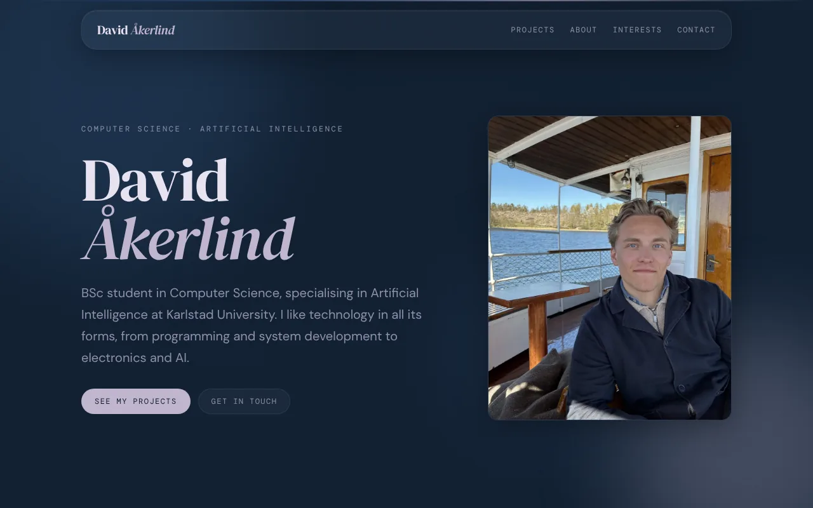

# David Åkerlind – portfolio

Source for my personal portfolio, live at **https://davidakerlind.com**.



It is a single-page site with four sections: selected projects, about me (education and experience), my interests (running, golf, skateboarding and a few study tools I built) and contact. The design is glassmorphism on a dark navy backdrop, with its own small design system.

## Built with

- [React](https://react.dev) 19 and [Vite](https://vite.dev) 7
- Plain CSS with design tokens, no CSS framework and no router library
- Fonts self-hosted with [Fontsource](https://fontsource.org) (DM Serif Display, DM Sans and DM Mono), so the site makes no third-party requests
- Pages are rendered to static HTML at build time and then hydrated, so they are readable without JavaScript and fast to load
- [Cloudflare Pages](https://pages.cloudflare.com) for hosting

## Getting started

You need Node.js 22 (`.node-version` pins it; Vite 7 needs at least 20.19).

```sh
npm install
npm run dev
```

| Command           | What it does                                                                 |
| ----------------- | ---------------------------------------------------------------------------- |
| `npm run dev`     | Starts the local dev server                                                  |
| `npm run lint`    | Runs ESLint                                                                  |
| `npm run build`   | Builds the site into `dist/` and renders each page to static HTML            |
| `npm run preview` | Serves the production build locally                                          |

## Where things are

```
src/
  components/   Reusable pieces: GlassCard, Button, Timeline, Footer, ...
  pages/        HomePage and its sections, the style guide and the 404 page
  data/         The content: projects.js, about.js, outside.js and links.js
  assets/       Images, logos and video (photos and video have no location or device metadata)
  index.css     Design tokens (colors, type, spacing, motion) and the reset
scripts/
  prerender.mjs Renders the pages to HTML and adds the SEO tags after the build
public/         robots.txt, sitemap.xml, _headers, favicons and the share image
```

To change what the site says, edit the files in `src/data/`. To see every token and component, open `/styleguide` (use `npm run dev`, or a Cloudflare preview URL). That page is a preview only and is kept out of search results.

## Deployment

Cloudflare builds the site from this repository with `npm run build` and serves the `dist/` folder. Pushing to `main` deploys to production, and every other branch gets its own preview URL.

## Working on it

Work happens on short-lived branches named `<number>-<what-it-does>`, for example `28-contact-and-footer`. Finished branches are merged into `dev`, and `dev` is merged into `main` when it is ready to go live. `npm run lint` and `npm run build` must both pass first.

Coding conventions, the design-system rules and the content rules are written down in [`CLAUDE.md`](CLAUDE.md).
